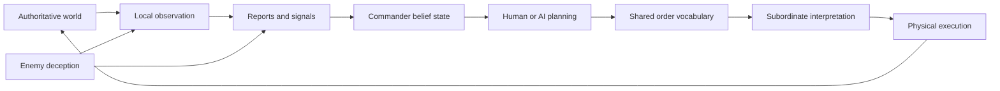

# FortressLab: Full Game Concept Pitch

**Working title:** FortressLab
**Tagline:** Design the fortress. Test the strategy. Survive the consequences.
**Date:** 2026-08-15
**Document type:** Hybrid creative-vision and product pitch
**Status:** Corrected draft 2 (restoration pass) — supersedes the first assembled draft
**Product model:** Premium, PC-first, single-player-first, mod-friendly, with asynchronous community features
**Core product:** Fortification design and construction, with adversarial evaluation delivered as an evidence-backed report rendered on the player's own model
**Extension tier:** Dynamic siege simulation, autonomous commanders, human Commander Modes, historical and community layers
**Presentation doctrine:** No individual human or animal is ever rendered, at any tier. Terrain, architecture, and mobile siege engines are rendered as physical objects; personnel formations appear only as visual indications of presence, and siege-engine crews remain abstracted
**Technical foundation:** [FortressLab POC Design](2026-08-15-fortresslab-poc-design.md). Stage-1 work is foundation, not prototype: its schemas, evidence model, and evaluator logic carry into the product, and the evaluator's overlays and evidence system are the shipped presentation layer of the core game
**Vision boundary:** This document names the core product first and separates the surrounding vision into an extension ladder (Section 26)

**Corrections in this draft:**

- Core product restored to primary framing, consistent with the POC specification ("the evaluator is the product under test"). The previous draft deferred the playable product to ladder stage 6.
- Presentation doctrine applied throughout: no individually rendered soldiers, animals, or NPCs at any tier; personnel formations are displayed as presence indications, while mobile siege engines may be rendered and simulated as physical units (§2, §4.6, §5.8, §21.1).
- §14.1 belief granularity corrected to command level; the previous draft implied per-actor belief states.
- §15 gains the war-room siting tradeoff (§15.2); the belief map updates from reports, never from rendered aides.
- §16 rewritten around the consequence takeover; reflex minigames explicitly excluded.
- §21 restated as deliberate fidelity asymmetry; §23.3 example corrected to doctrine.
- §26–28 tiered into core product and extension; §29 gains the core-game signature story.

## 1. The Pitch

FortressLab is a fortification design and siege-analysis game in which the player begins as the architect, not the battlefield commander. Given an empty landscape, the player decides where a settlement or fortress should stand, shapes the terrain through plausible engineering, and constructs a defensible system from walls, towers, gates, ditches, bridges, interiors, mechanisms, logistics, communications, traps, and fallback positions.

The core game is a laboratory loop. When construction is complete, the design is submitted to adversarial evaluation: an analytical enemy generates and ranks courses of action against it, and the player receives a report — rendered directly on their own model as granular visuals, overlays, and scrubbable causal timelines — showing where the design would fail, why, and what a capable attacker would exploit. The player investigates, revises, and resubmits. The core product is a wind tunnel for castles.

The game does not decide that a castle is good because it has high walls. It tests whether those walls can be supported, supplied, observed, reinforced, repaired, escaped from, captured, reversed, undermined, burned, flooded, sabotaged, or turned into a trap for either side.

The extension tier grows the same simulation into live sieges commanded by autonomous attacking and defending commanders who observe imperfectly, form beliefs, issue orders through subordinates, adapt to damage and deception, and exploit whatever the architect has actually made possible. A live siege is presented through changes to terrain and structures, physically rendered mobile siege engines, and abstract indications of personnel presence — never as individually rendered armies. The long-term product expands further into historical reconstructions, counterfactual matchups, a light narrative commission campaign, community siege trials, and optional high-level Commander Modes. In Commander Mode, the player receives incomplete reports at a physical war-room table and issues intent to AI subordinates—never selects and drags units like an omniscient RTS god.

## 2. Product Snapshot

| Category | Definition |
|---|---|
| Genre | Fortification design, engineering sandbox, siege analysis, strategy laboratory |
| Core product | Design and construction with adversarial evaluation: build, submit, read the report, revise |
| Extension tier | Live siege simulation, autonomous commanders, Commander Modes, historical and community layers |
| Primary fantasy | Become the architect whose structure must survive intelligent adversaries |
| Secondary fantasy (extension) | Become a fallible attacker or defender commander operating through reports and orders |
| Core platform | PC |
| Camera | Strategic 3D construction, analytical cutaways and overlays, report and replay playback on the player's model; embodied war room (extension) |
| Core play | Single-player sandbox, adversarial evaluation reports, curated commissions |
| Presentation doctrine | Architecture, terrain, and mobile siege engines rendered physically; personnel formations indicated as presence, never individually rendered |
| Community | Shared fortresses, scenarios, commander profiles, challenge configurations and replays |
| Commercial form | Premium game; no gameplay microtransactions |
| Visual target | Grounded, high-fidelity terrain, structures, mobile siege engines, and physical consequence, with deliberately abstracted personnel presence and a crafted miniature war-room map (extension) |
| Central technology | One causal world simulation shared by human and AI agents |

## 3. The Player Promise

FortressLab promises that architecture is strategy expressed in physical form.

The player may design a gatehouse that appears weak but draws attackers into concealed internal firing positions. That deception succeeds only if reconnaissance plausibly misses the danger and the defenders can actually occupy, supply, communicate with, and fire from those positions.

The player may build a drawbridge with an exposed lifting chain. An attacker can discover, reach, and sabotage that chain. If the mechanism fails, the bridge may fall, jam, twist, or become unusable according to its geometry and loading—not because the bridge exhausted a generic health bar.

A tower struck by artillery may partly collapse. Falling material can kill personnel, block reinforcement routes, crush supplies, fill a ditch, create attacker cover, expose an interior compartment, or make a climbable ramp. Both commanders receive different evidence of the event and may reach different conclusions.

An attacker may poison a water source, divert a river, infiltrate disguised agents, mine a foundation, blockade supplies, manufacture false intelligence, or decline battle entirely. These are not bespoke alternative-victory buttons. They emerge from reusable systems for substances, water, earthworks, access, logistics, information, health, time, and command.

In the core product, these consequence chains are computed and delivered as causal evidence on the player's model. In the extension tier, they additionally unfold live. The chains, and the systems that produce them, are the same.

The guiding ambition is **strategy completeness**:

> A plausible plan should fail because the simulated world resists it, not because the developers forgot to create the corresponding action button.

Literal completeness is impossible. FortressLab approaches it by building a rich causal vocabulary whose primitives combine into plans the designers did not explicitly script.

## 4. What Makes It Distinct

### 4.1 The architect is the core player role

The player does not compensate for a bad design by micromanaging defenders. Once a canonical test begins, autonomous forces must interpret and use the architecture themselves. The structure communicates the player's strategy through access, visibility, protection, capacity, redundancy, deception, and failure behaviour.

### 4.2 The attacker is an adversarial strategist

The game does not send troops toward a designated weak point. An attacker observes, generates competing courses of action, weighs uncertainty, conducts probes, commits resources, learns from results, and replans. Different commander profiles can interpret the same evidence differently without receiving different physical rules.

### 4.3 The defender is equally autonomous

Defenders allocate forces, preserve reserves, repair damage, reinforce sectors, abandon untenable works, counterattack, deceive, and fall back through compartments. A brilliant castle can be squandered by poor command; a modest castle can be elevated by excellent operational use.

### 4.4 Failure changes the battlefield

Structures do not transition cleanly from intact to destroyed. Damage changes load paths, mechanisms, accessibility, visibility, cover, morale, logistics, and command connectivity. Every failure is potentially a new opportunity for both sides.

### 4.5 Conclusions remain explainable

Every important evaluation links back to terrain, geometry, observations, assumptions, model outputs, and causal events. The game provides evidence and comparisons rather than concealing its reasoning behind a universal castle score.

### 4.6 The battle is read through the building

No soldier, crew member, civilian, or animal is ever rendered as an individual asset. Personnel formations appear only as clear visual indications of presence. Mobile siege engines are the deliberate exception: rams, siege towers, trebuchets, mobile mantlets, and comparable machines may be rendered and simulated as individual physical units because their geometry, mechanisms, movement, emplacement, damage, and obstruction directly alter the siege. Their crews remain abstracted. A siege is read through what happens to the built world and the machines acting upon it: impacts blooming on walls, engines moving or bogging across terrain, earthworks advancing, fires, floods, collapses, and breaches. The fortress remains the protagonist.

### 4.7 The core game is complete before the war is animated

The shippable core is the design laboratory: construction plus adversarial evaluation delivered as an evidence-backed report. Live simulation, autonomous commanders, and Commander Modes extend a finished product; they are not prerequisites for one.

## 5. Design Pillars

### 5.1 Architecture is executable strategy

Every opening, stair, wall walk, storeroom, culvert, tower, gate, bridge, mechanism, command post, and fallback route can affect what forces are capable of doing.

### 5.2 One world, one set of rules

Human players, AI commanders, subordinates, forces, projectiles, mechanisms, fluids, fires, and structures interact with the same authoritative state. Difficulty never grants secret geometry, teleportation, hidden resources, or physics bonuses.

### 5.3 Perception is not reality

Commanders act on beliefs assembled from viewpoints, reports, memory, inference, reconnaissance quality, and deception. A perfect simulation state exists for causality and replay, but no active commander sees it directly.

### 5.4 Systems replace scripted solutions

Poison, flooding, sabotage, mining, fire, starvation, infiltration, collapse, surrender, and battlefield deception arise from interoperable systems. Scenario code defines circumstances and objectives, never the required solution.

### 5.5 Strong designs fail well

The best fortress is not necessarily one that never loses a component. It fails slowly, locally, predictably, recoverably, and inconveniently for the enemy. Redundancy, graceful degradation, containment, maintainability, and reverse defensive value matter alongside raw resistance.

### 5.6 Historical honesty over theatrical precision

Historical inputs expose their evidence quality and uncertainty. The game seeks bounded causal fidelity, not a claim to recreate every human motive or guarantee one recorded outcome.

### 5.7 Experimentation is the progression engine

The player builds, tests, investigates, revises, and compares. Knowledge—not an arbitrary percentage bonus—is the central form of progression. Every design choice has logical, exploitable consequences; the space of viable and terrible strategies is conceptually unbounded, and discovering personally which is which — garbage or brilliant — is the game.

### 5.8 Architecture and siege engines are rendered; personnel are indicated

At no tier is an individual human or animal drawn. Personnel presence is abstract by doctrine, not by budget: abstraction is what makes uncertainty representable. An indicated formation can be approximate, stale, or wrong in ways an animated soldier cannot. Mobile siege engines may be rendered as physical units because their exact geometry and state have causal consequences; their operators are represented through abstract crew capacity. On the battlefield and in omniscient replay, an engine has an authoritative physical state. On a commander's war-room map, it appears only when observed or reported, as a potentially approximate, stale, misidentified, or deceptive representation. The gap between physical truth and command belief therefore remains visible without hiding mechanically consequential machines.

## 6. Core Game Loop

1. **Survey the landscape.** Inspect topology, geology, water, routes, weather exposure, resources, and likely enemy assembly areas.
2. **Choose a defensive concept.** Decide what the fortress protects, how it shapes enemy movement, and where it can afford to fail.
3. **Engineer the site.** Excavate, terrace, quarry, drain, dam, tunnel, grade, and build roads within scenario constraints.
4. **Construct the fortification.** Draw walls and ditches, place structures, design interiors, and assemble mechanisms.
5. **Organise the defence.** Provide observation, communications, circulation, supplies, reserves, command posts, medical access, repair capacity, and fallback positions.
6. **Select the test.** Choose forces, equipment, doctrine, commander profiles, intelligence, preparation time, weather, logistics, objectives, and uncertainty.
7. **Lock the canonical run.** The design is inherited as-is. The architect cannot rescue it through battlefield micromanagement.
8. **Receive the adversarial report.** The evaluator attacks the design and returns its findings — ranked courses of action, exploited weaknesses, causal chains, confidence, and assumptions — rendered as overlays, annotations, and scrubbable timelines on the model itself. In the extension tier, the siege can additionally be observed live as the physical, informational, and logistical state evolves.
9. **Conduct the post-mortem.** Compare ground truth, faction beliefs, reports, orders, damage, routes, and decisive causal chains.
10. **Fork and improve.** Change one element or redesign freely, then compare the new defensive performance envelope.

## 7. Game Modes

Modes are labelled by tier. Core modes ship with the core product; extension modes consume it.

### 7.1 Free Construction Sandbox (core)

An unrestricted laboratory with complete building tools, configurable terrain, editable scenario variables, and optional removal of economic and time constraints. Unlimited resources waive scarcity, not causality: an impossible unsupported roof remains impossible.

### 7.2 Siege Director (core; grows in extension)

The director configures both sides' circumstances, broad intentions, doctrine, knowledge, and objectives, then launches an evaluation. In the core product the output is the adversarial report. In the extension tier the same configuration launches a live autonomous simulation; canonical comparative runs become non-interactive after launch, and optional interventions remain available for experiments but mark the run as modified.

### 7.3 Commission Campaign (core; deepens with each extension)

A light, grounded fictional career presents increasingly difficult architectural commissions. It teaches systems through genuine defensive problems while supporting recurring characters, political constraints, revisited locations, and consequences that persist across later contracts.

### 7.4 Historical Reconstructions (extension)

Curated scenarios reconstruct terrain, fortifications, forces, equipment, commanders, logistics, knowledge, weather, and objectives from documented evidence. The simulation is not forced toward the recorded sequence or result.

### 7.5 Counterfactual Laboratory (extension; early forms available in core through evaluator configuration)

Players vary independent components without granting unintended advantages: modern doctrine with medieval equipment, a Roman army confronting a player-built castle, a historical commander given better reconnaissance, or the same siege under different weather and preparation.

### 7.6 Community Siege Trials (extension; design and challenge sharing can begin in core)

Players publish versioned castles, terrain, scenarios, commander profiles, design constraints, and challenge seeds. Other players test them with AI profiles or submit high-level plans asynchronously. Shared results remain comparable because content and model versions are recorded.

### 7.7 Attacker Commander Mode (extension)

A later-stage mode places the player in a physical command location. The player studies a fallible war-room map, requests reconnaissance, evaluates reports, issues high-level orders and contingencies, and waits for subordinate interpretation and delayed consequences.

### 7.8 Defender Commander Mode (extension)

The defender knows the intended fortress plans but receives only reported updates about damage, occupation, supplies, casualties, blocked routes, mechanisms, and enemy activity. The player reallocates reserves, changes defensive priorities, orders repairs, seals compartments, conducts sorties, and attempts to infer the attacker's true purpose.

### 7.9 Explicitly Not an RTS Control Mode

There is no intended mode, at any tier, in which the player selects individual formations and directly drags them around the battlefield. High-level command must preserve uncertain information, communication delay, subordinate agency, and the physical constraints of the world.

## 8. Terrain and Site Selection

Each scenario begins with terrain rather than an empty flat construction pad. The landscape contains strategically meaningful:

- Elevation, slopes, ridges, cliffs, valleys, saddles, and dead ground.
- Rivers, streams, marshes, coastlines, groundwater, and drainage basins.
- Soil, rock, bearing capacity, erosion risk, and excavation difficulty.
- Roads, crossings, settlements, farmland, quarries, forests, and supply approaches.
- Lines of sight, concealed assembly areas, high ground, and artillery positions.
- Seasonal and weather-dependent changes.

The player must decide whether a hill's observation advantage outweighs difficult supply, whether a valley controls movement but invites flooding and plunging fire, and whether water access creates resilience or a contamination route.

Terrain is altered only through physical engineering actions such as excavation, grading, tunnelling, quarrying, damming, ditching, terracing, and embankment construction. Even unrestricted sandbox mode preserves the structural and hydrological consequences of those actions. Free terrain sculpting would erase the central site-selection problem.

## 9. Construction System

### 9.1 Multi-scale authoring

The building interface moves smoothly through five scales:

1. Terrain and strategic layout.
2. Walls, ditches, roads, compartments, and major buildings.
3. Rooms, floors, stairs, passages, supports, and fighting positions.
4. Hinges, ropes, chains, pulleys, gears, winches, brakes, counterweights, locks, and controls.
5. Operational assignments, stores, communication routes, security, and emergency procedures.

### 9.2 Procedural but exact construction

Players draw walls, ditches, roads, and other linear works across terrain. The system generates coherent geometry that follows the path while preserving editable parameters and exact relationships. Towers, gates, openings, stairs, and support structures can be inserted into existing works. Cutaway, cross-section, and exploded views expose interiors and mechanisms.

Simple tools produce useful structures quickly. Advanced control permits exact dimensions, component placement, material layers, connection types, and reusable assemblies. Saved assemblies remain transparent collections of functional parts rather than indestructible black-box prefabs.

### 9.3 Engineered mechanisms

Every engineered function has:

- Physical components.
- A load or power path.
- Controls and operating requirements.
- Access and maintenance needs.
- Environmental exposure.
- Condition and material state.
- Multiple plausible failure modes.

A drawbridge therefore consists of a deck, pivots, lifting members, ropes or chains, counterweights or winches, guides, brakes, anchorages, operating space, and protective architecture. Attackers can target whatever they can plausibly perceive and reach.

### 9.4 Constraints without city-builder sprawl

Commission and historical scenarios constrain labour, time, technology, tools, materials, transport, and maintenance. These inputs exist to shape engineering decisions, not to require constant taxation, housing, crop-market, and production-chain management. The economy is a boundary condition on architecture rather than the game's dominant activity.

## 10. Engineering Overlays

Construction tools expose consequences without demanding manual stress calculations. Individually selectable overlays include:

- Terrain suitability, foundation pressure, settlement, and slope risk.
- Watersheds, drainage, flood paths, water storage, and contamination exposure.
- Compression, tension, shear, thrust, support, and progressive-collapse dependencies.
- Mechanism loads, power transmission, accessibility, redundancy, and exposed components.
- Visibility, occlusion, dead ground, and observation coverage.
- Weapon range, firing arcs, overlapping coverage, enfilade, and reverse firing value.
- Attacker approaches, formation width, siege-equipment access, and engineering opportunities.
- Defender circulation, reinforcement, withdrawal, evacuation, and congestion.
- Supplies, ammunition, water, medical access, workshops, and repair routes.
- Messenger paths, signal coverage, command latency, and isolated sectors.
- Infiltration, sabotage, internal access, and headquarters exposure.
- Compartment containment, fallback strength, capture utility, and lodgement liability.
- Predicted debris, blocked routes, new cover, and climbable collapse geometry.

In the core product these overlays are not auxiliary diagnostics. Together with the adversarial report, they are the primary way a siege is experienced: the analytical view is the game view.

The interface can answer "why is this vulnerable?" by tracing evidence through geometry and assumptions. It does not offer a universal "fix my castle" command. Any rating is conditional on the declared threat, and catastrophic weaknesses remain visible instead of disappearing into an average.

## 11. The Causal Simulation (extension tier)

The core product's causal model is the static analytical evaluation inherited from the POC: exact geometry, spatial fields, semantic graphs, perception, courses of action, and evidence. The dynamic simulation described below is the extension-tier engine that animates those same systems.

### 11.1 Hybrid fidelity

FortressLab does not attempt to run a maximum-resolution universe simulation. It preserves exact authored geometry and functional relationships, evaluates the wider battlefield through efficient spatial fields and graphs, and activates finer physical simulation where interaction demands it.

Critical impacts, moving mechanisms, local fracture, unstable structures, active fluids, fire fronts, and settling debris receive detailed treatment. Stable distant structures can be represented by validated reduced models until their state changes. The transition in fidelity must preserve mass, connectivity, load transfer, obstruction, and other consequences visible to gameplay.

This avoids two failures:

- A global per-brick rigid-body simulation that is expensive, unstable, and difficult to validate.
- A conventional attribute system in which elaborate geometry ultimately resolves to hidden hit points.

### 11.2 Persistent state change

Damage is not a temporary effect. Cracks, displaced components, weakened supports, burned timbers, flooded spaces, contaminated stores, broken mechanisms, and settled debris remain part of the world. Repair, clearing, reinforcement, bypass, and demolition are physical responses performed by capable actors with tools, access, materials, and time.

## 12. Interacting System Families

System families arrive progressively. The core product models the subset required for static adversarial evaluation; each family joins the live simulation in the extension tier. Presentation of every family follows the doctrine: consequences appear on terrain, structures, and presence indications.

| System | Player-authored decisions | Consequences |
|---|---|---|
| Structural load paths | Arches, vaults, columns, buttresses, wall thickness, floors and roof supports | Redistribution, local failure, progressive collapse and survivable segmentation |
| Foundations and ground | Site choice, footing depth, preparation, drainage and material | Settlement, cracking, undermining, erosion and slope failure |
| Materials | Stone, mortar, brick, earth, timber, metals, quality and condition | Compression, tension, shear, spalling, burning, rot, deformation and weathering |
| Mechanisms | Hinges, chains, ropes, pulleys, gears, counterweights, brakes and locks | Operation, overload, severance, jamming, sabotage and manual fallback |
| Projectiles | Weapon, energy, incidence, target geometry, material layers and condition | Penetration, deflection, shock, fracture, splinters, collapse initiation and debris |
| Fire and atmosphere | Fuel, ventilation, firebreaks, roof design and stores | Spread, smoke, visibility loss, heat injury, abandonment and structural weakening |
| Hydrology | Rivers, rainfall, cisterns, wells, ditches, culverts, dams and drainage | Supply, flooding, erosion, contamination, extinguishing and deliberate inundation |
| Substances and health | Water, food, poison, smoke, waste, disease sources and medicine | Dispersal, detection, consumption, illness, treatment and workforce degradation |
| Terrain engineering | Excavation, mines, embankments, roads, tunnels, fascines and ramps | Changed access, stability, drainage, concealment and siege opportunities |
| Debris | Structural segmentation, room layout, slopes and impact direction | Fatality, blocked routes, new cover, filled ditches, ramps and secondary loading |
| Human operability | Crew space, leverage, controls, access, light and working conditions | Mechanisms that can or cannot be operated, repaired, defended or sabotaged |
| Internal logistics | Corridors, stairs, magazines, caches, water points and workshops | Congestion, reinforcement delay, supply loss, isolation and recovery capacity |
| Siege engineering | Mining, rams, ladders, towers, artillery, bridges and counterworks | Reciprocal terrain and structural transformation |
| Communications | Sightlines, bells, flags, runners, command posts and standing orders | Delayed awareness, isolated sectors, false reports and delegated initiative |
| Psychology and negotiation | Leadership, losses, supply outlook, perceived strength and objectives | Morale change, refusal, surrender, retreat, bargaining and continued resistance |
| Weather and season | Rain, snow, wind, temperature, daylight and ground state | Mud, traction, range, visibility, water flow, material condition and activity rates |

Each family exposes reusable state and actions to every actor. A poisoning operation uses the same access, substance flow, detection, consumption, health, reporting, and command systems whether a scenario designer anticipated the tactic or not.

## 13. Causal Consequence Chains

In the core product these chains appear as reported findings with complete causal evidence. In the extension tier they unfold as live events. The chains themselves, and the systems that produce them, are identical.

### 13.1 Drawbridge sabotage

An attacker observes that a lifting chain is exposed, determines an accessible firing or infiltration route, damages the chain, and changes the bridge's force balance. The deck may drop, twist, jam against damaged guides, or remain partly suspended depending on the surviving mechanism. The new geometry changes access to the gate and may injure nearby personnel or obstruct later repair.

### 13.2 Progressive tower collapse

A projectile hits a tower at an angle. Masonry fractures, a timber floor loses support, and loads redistribute through the remaining shell. A partial collapse kills or isolates defenders, blocks a stair, exposes an adjacent wall walk, and creates a rubble slope. The attacker sees an opportunity; the defender receives incomplete reports and must decide whether to reinforce, evacuate, barricade, or counterattack.

### 13.3 Water poisoning

An attacker acquires a contaminant, reaches a connected water source, introduces it without detection, and waits for dispersal and consumption. Defenders may notice taste, illness, a compromised guard route, or conflicting reports. Secondary cisterns, testing procedures, medical knowledge, and command judgement determine whether the operation causes inconvenience, severe degradation, surrender, or nothing useful.

### 13.4 River diversion

Attackers survey a watershed, identify a feasible intervention, move labour and tools, build earthworks, and accumulate or redirect flow. Water follows terrain, saturates soil, erodes roads, floods compartments, contaminates stores, and loads foundations. Defenders may sortie, drain, reinforce, evacuate, or construct counterworks. Victory comes from the interaction of ordinary systems rather than a "flood castle" script.

### 13.5 Missing-mechanic audit

When a plausible plan cannot be expressed during development, it is classified as one of:

1. Missing physical primitive.
2. Missing interaction between existing systems.
3. Missing actor capability.
4. Missing perception or planning vocabulary.
5. Legitimate technological, physical, or scenario constraint.

The preferred repair is a reusable primitive or interaction, never a one-use tactic button.

## 14. Command, Perception, and Agent Parity

*(Core product: perceived-versus-authoritative analysis. Extension tier: live belief-state command.)*

### 14.1 One authoritative world

The simulation maintains the physical truth. Belief is held at command level: each faction's commander — and, in the extension tier, subordinate formations — maintains a separate, incomplete belief state produced from observation and communication. Belief granularity follows the command hierarchy and never descends to individual soldiers, which do not exist as simulated or rendered individuals. Future information cannot retroactively correct decisions made with earlier evidence.

### 14.2 Humans and AI occupy interchangeable seats

A human receives reports through text, sound, physical viewpoints, and the war-room map. An AI receives semantically equivalent structured evidence. Both create orders through the same action vocabulary and depend on the same communication, subordinate, movement, logistics, and consequence systems.

An AI commander may not inspect hidden traps, walls, forces, routes, mechanisms, or structural condition. Even route planning operates on that agent's believed map rather than silently using the perfect world navigation graph.

### 14.3 Legitimate commander differences

Profiles vary through:

- Attention, memory, and ability to reconcile reports.
- Planning horizon and hypothesis generation.
- Doctrine, training, engineering knowledge, and habitual tactics.
- Risk tolerance, patience, confidence, and susceptibility to deception.
- Reconnaissance priorities and willingness to conduct probes.
- Delegation, communication style, and use of contingencies.
- Adaptation after unexpected results.
- Trust in particular sources and subordinates.

Difficulty and historical characterisation never grant physical bonuses or omniscience. Learning across independent runs occurs only when a campaign or scenario explicitly preserves that knowledge.

### 14.4 Shared order vocabulary

High-level orders specify:

- Objective and desired end state.
- Assigned formations, specialists, and equipment.
- Operational area or believed route.
- Timing and coordination conditions.
- Priority and acceptable risk.
- Engagement and resource restrictions.
- Withdrawal or abort conditions.
- Contingencies and delegated discretion.

Subordinates interpret intent according to competence, doctrine, temperament, local information, personnel, access, and changing conditions. Orders can arrive late, be misunderstood, become impossible, or prompt useful initiative.

## 15. The War-Room Interface

The commander's table is a physical representation of belief, not a live tactical display. It is assembled from direct observation, scouts, prisoners, civilians, messengers, signals, subordinate reports, inference, and older records.

Every element carries provenance:

- Who reported it.
- When it was observed.
- Where the source stood.
- How certain the report appeared.
- Whether other evidence corroborates or contradicts it.
- How stale it may now be.

The deliberately low-poly miniature is diegetic: carved wood or clay terrain, small structure models, pins, pieces, ink, annotations, dates, and uncertain boundaries. Its simplified geometry expresses limited knowledge rather than the visual budget of the battlefield. The map updates as reports arrive — through the interface, never through rendered figures. Nothing moves simply because the hidden world changed.

The commander can observe from physically accessible viewpoints, subject to travel time, weather, light, occlusion, danger, and available optics. Leaving the table may improve direct knowledge while delaying other decisions.

### 15.1 Defender information

The defender begins with plans for the castle as constructed but not perfect live awareness. Smoke, noise, darkness, damaged signals, blocked corridors, missing messengers, lost sectors, and local panic can make the interior as uncertain as the exterior.

Defensive orders include reinforcement, withdrawal, reserve commitment, firing policy, supply movement, repair, firefighting, rubble clearing, barricading, compartment sealing, counter-mining, sorties, local counterattacks, trap activation, bridge destruction, and fallback preparation.

The fortress is therefore also a sensor, logistics, and command network. Observation posts, messenger routes, signals, protected headquarters, local caches, redundant access, and delegated sector command are architectural features.

### 15.2 The commander's seat is architecture

The war room is a designed component, and its placement is one of the sharpest tradeoffs in the game: intelligence freshness against commander survivability against internal circulation.

A war room positioned forward and high receives frequent, accurate, current reports and commands direct observation — and exposes the commander to bombardment, infiltration, and the ordinary physics of the structures around it. A war room buried behind reinforced structure, complex barricades, kill zones, and fallback routes is genuinely hard to reach — and every one of those measures delays friendly messengers as effectively as it delays enemies. Protection is purchased with ignorance: a staler map produces larger belief error, and a commander with larger belief error is easier to deceive.

Every intelligence channel carries its own cost, in its own currency:

- **Messengers** cost latency and route risk, both governed by the architecture they must traverse.
- **Signals** — bells, horns, flags, beacons, sightlines — cost secrecy and weather-dependence, and a visible signal network is information the enemy reads too.
- **Personal observation** from the keep, parapets, or towers costs exposure and time away from the table.

No channel is free, and the system does not permit removing all three costs at once. Every arrangement of the commander's seat is legitimate, and every arrangement is exploitable. Discovering which is which is the point.

## 16. Embodied Command and Commander Mortality (extension tier, late stage)

Commander Mode gives the player an authoritative physical location and locks the player to what the commander can plausibly see, hear, and deduce: the war-room map, arriving reports, and personal observation from physically accessible vantage points. The headquarters has entrances, windows, roof and floor exposure, security procedures, locks, checkpoints, messenger traffic, escape paths, structural supports, and surrounding terrain relationships.

Attackers may infer the headquarters from observation, prisoners, documents, signal activity, or traffic, and attempt a causal decapitation operation using physically supported access — tunnels, drainage passages, posterns, roofs, bribery, captured procedures, or confusion during a breach. No attempt ever succeeds because an invisible probability roll said so.

The counterplay lives upstream, in architecture, security procedure, and attention. Warning arrives as it plausibly would: a missing guard report, an incorrect challenge response, an unexplained open door, an interrupted signal, unusual silence, footsteps outside the room — conveyed through sound, reports, and the interface, never through a rendered figure.

Commander death is a consequence takeover, not a contest. When a decapitation operation or an ordinary physical consequence reaches the commander, the player's point of view is briefly hijacked to show the result of the exploited failure mode: the war-room roof caving under a burning projectile of stone and oil whose trajectory the geometry permitted, or a knife simply appearing — the assassin never shown — followed by the consequences. This is explicitly not a reflex minigame. No last-second input can overturn what the simulation has already resolved; a reaction prompt that overrode physical resolution would violate the one-world rule (§5.2). The takeover is the receipt, not the test.

Death receives the same forensic treatment as any other event: the post-mortem traces the causal chain — the access route, the procedural gap, the overlay warning that went unheeded. Violence and startle presentation remain configurable (§21.4).

Commanders may also die through bombardment, fire, collapse, flooding, or other ordinary consequences. A poorly placed war room beneath an exposed roof can be destroyed by a projectile whose geometry and trajectory make the strike possible.

Death results depend on the scenario and prior state. It produces immediate defeat when decapitation makes continued resistance implausible. A prepared succession chain may instead transfer authority after delay, confusion, lost knowledge, and morale shock. This is a late-stage feature added only after construction, damage, perception, and command systems are sound.

## 17. Time Across a Siege

*(Core-product reports summarise siege time analytically. Live time compression applies to extension-tier observed sieges.)*

Sieges operate across several temporal scales:

- **Seconds and minutes:** assaults, counterattacks, collapse, fire, sabotage, and infiltration.
- **Hours and days:** bombardment, reconnaissance, repairs, earthworks, supply movement, and negotiations.
- **Weeks and months:** blockade, mining, disease, depletion, weather cycles, political pressure, and relief operations.

The simulation preserves continuous causality while varying resolution and playback speed. Players can accelerate time, advance until a chosen report or event, schedule standing orders, and automatically slow when consequential activity begins. At high compression, routine processes use validated larger intervals while contact and unstable interactions activate finer resolution.

Commander difficulty may limit automatic pauses, perfect alerts, and consequence-free order revision. It never requires the player to experience a historical blockade at one-to-one wall-clock speed.

Exact compression rates, slowdown triggers, notification rules, and pause restrictions remain tunable through playtesting. Enjoyable command rhythm is an empirical design problem, not something this pitch pretends to solve numerically.

## 18. Historical and Counterfactual Scenarios (extension tier)

### 18.1 Scenario composition

Historical scenarios combine independently versioned:

- Terrain, waterways, weather, season, and visibility.
- Fortification geometry, material, maintenance, and prior damage.
- Force size, composition, training, health, and equipment.
- Engineering, medical, logistical, and communication capability.
- Supplies, routes, civilians, sanitation, and political pressure.
- Commanders, subordinates, doctrine, personality, and objectives.
- Information initially available to every faction.
- Reinforcement, relief, withdrawal, surrender, and victory conditions.

### 18.2 Evidence standard

Historical inputs are labelled as measured within a reconstruction, modelled, inferred, disputed, or intentionally counterfactual. Sources and competing interpretations remain accessible. Where evidence supports only a range, the scenario uses a declared range rather than a theatrical exact value.

### 18.3 Reproduction without reenactment scripts

The simulator is allowed to reproduce, vary from, or expose missing factors in the historical record. Validation asks whether repeated runs recover important vulnerabilities, pressures, decisions, and plausible outcomes—not whether every soldier falls at the recorded minute.

An authentic result is a credible distribution and causal resemblance under declared assumptions. A forced sequence is merely theatre.

### 18.4 Counterfactual independence

Equipment, doctrine, knowledge, personality, logistics, and objectives remain separate. This permits a modern unit defending a medieval fortress without granting magical ammunition, a Roman army using Roman equipment under a player-authored command plan, or a historical general receiving intelligence they never possessed.

### 18.5 Victory conditions

Scenarios may require capture, retention, surrender, survival until relief, delay, evacuation, supply-route control, preservation of forces, destruction of siege works, leadership survival, commander capture, or another explicit operational outcome. Eliminating every enemy is neither universal nor usually historically credible.

## 19. The Commission Campaign (core; deepens with each extension)

The recommended narrative is a grounded fictional career within a historically plausible medieval world, separate from the sourced historical anthology.

The player becomes an increasingly trusted military architect. Commissions pose real conflicts:

- Hold a river crossing without destroying the trade route.
- Protect a town while preserving productive farmland.
- Rebuild a fortress whose passages are known to the enemy.
- Modernise an old keep against new siege technology.
- Construct quickly with weak material, limited labour, or hostile politics.
- Repair a damaged fortress while an enemy approaches.
- Reconcile a patron's prestige project with a commander's operational needs.

Recurring patrons, masons, engineers, commanders, rivals, spies, merchants, and communities react to systemic results. The story establishes pressures and consequences but never forces a breach or victory to satisfy dialogue.

Some sites return years later. Earlier structures have aged, enemies have learned, political priorities have shifted, weapons have changed, and the player must extend or defend their own architectural legacy. A fortress once designed by the player may later be encountered from the attacking side.

Failure can continue the story through lost territory, damaged reputation, reconstruction, altered resources, or a more desperate later commission. Free replay remains available for players who prefer optimisation.

Campaign progression introduces complexity and awards case studies, advanced diagnostic instruction, cosmetic styles, presentation options, specialist access, blueprints, and narrative opportunities. Sandbox construction tools are not artificially locked behind campaign completion.

## 20. Evaluation, Replay, and Forensic Learning

In the core product, the report is the payoff, and it is watchable evidence rather than tabulated output: the cheapest breach path drawn crawling across the wall it defeats, a flood filling the magazine on a scrubbable timeline, exposure traced along an approach — findings annotated on the model the player built, never a spreadsheet with a castle attached.

Every run records an inspectable event history:

- Authoritative physical state changes.
- Each faction's belief state over time.
- Observations, reports, sources, delays, and contradictions.
- Orders as issued, transmitted, interpreted, and executed.
- Structural, hydrological, logistical, health, and access consequences.
- Courses of action considered and why they gained or lost priority.
- Major unrealised alternatives.
- Model assumptions, uncertainty, versions, and seed.

Items involving live belief evolution and order transmission apply to extension-tier runs; core-product reports record the evaluator's evidence, courses of action, unrealised alternatives, assumptions, and seeds.

Analytical values distinguish measurements inside the simulation from modelled consequences and historically inferred inputs. Composite findings preserve those classifications and expose sensitivity, missing information, and numerical instability rather than converting uncertainty into decorative confidence percentages.

Replay permits unrestricted cameras, timeline scrubbing, event filters, overlays, ground-truth comparison, and side-by-side belief maps. A player can select a surprising result and follow its provenance backward through the causal chain.

Designs can be forked and compared under controlled mutations. The evaluator reports:

- Cheapest credible attacker courses of action.
- Catastrophic single-point weaknesses.
- Robust properties across many threats.
- Capture and reverse-use liabilities.
- Deception differentials between perceived and actual cost.
- Sensitivity to uncertain inputs and commander profiles.
- Numerical and resolution stability.

The result is a **defensive performance envelope**, not a universal score. A castle can be excellent against one threat and catastrophically unsuited to another.

## 21. Presentation, Sound, and Accessibility

### 21.1 Visual identity

The presentation budget is spent asymmetrically, and the asymmetry is the visual identity. Terrain, architecture, materials, mobile siege engines, lighting, weather, water, fire, smoke, and destruction target grounded, high fidelity — the features that sell physical consequence. Human and animal forces receive the opposite treatment: enemy and friendly personnel formations are displayed as clear visual indications of presence, never as individually rendered people or creatures. Mobile siege engines are physically rendered and simulated, while their crews remain abstract. "AAA-leaning" refers to the engineered world and its consequences, not to animated armies.

This is the same intentional abstraction as the war-room miniature: simplified representation carrying meaning. On the field, personnel-presence indications and rendered siege engines represent ground truth; on the commander's table, formation and equipment markers represent belief — and the difference between the two displays is the perception gap made visible. A reported engine may therefore appear at an approximate position, under the wrong classification, or remain on the map after it has moved or been destroyed. Abstraction makes uncertainty representable without abstracting away the machines whose dimensions, routes, mechanisms, and damage matter to the fortress.

The game remains visually beautiful outside analytical views. Engineering overlays are optional, layered, and legible. They do not turn the ordinary world into permanent diagnostic colour soup.

### 21.2 Camera authority

- Architect and Director Modes allow unrestricted survey, cutaways, overlays, and cinematic observation.
- Commander Mode permits the war room and physically accessible viewpoints only.
- Replay Mode exposes free camera, ground truth, faction beliefs, and the complete timeline.

Camera permissions can never become a hidden information cheat.

### 21.3 Sound as information

Distant impacts suggest direction and scale. Structural groans warn of redistribution or imminent failure. Bells, horns, runners, and shouted messages carry command information. Footsteps, interrupted signals, unusual silence, water, fire, and machinery communicate events before formal confirmation. With forces abstracted on screen, sound carries much of the battle's presence: an assault is heard before it is inferred.

### 21.4 Accessibility

Features include scalable text, report narration, subtitles, colour-independent overlay patterns, remappable controls, configurable simulation speed, causal explanations without time pressure, and adjustable violence and startle presentation. The violence and startle setting governs the §16 consequence takeover. Analytical depth must not depend on perfect colour vision, rapid reading, or tolerance for graphic surprise.

## 22. Modding and Asynchronous Community

FortressLab is designed around versioned, data-defined packages for terrain, structures, materials, mechanisms, equipment, forces, doctrine, commanders, objectives, scenarios, and reports. Stable schemas and project-owned interfaces make modding a foundational capability rather than a late file-replacement accident.

Players can share:

- Fortresses and reusable engineered assemblies.
- Terrain and site-selection challenges.
- Historical or fictional scenarios.
- Commander, doctrine, force, and equipment profiles.
- Commission-style constraints.
- Seeds, experiment definitions, and result bundles.
- Replays and forensic explanations.

Asynchronous challenges ask other players to design against a fixed attacker, author an attack plan against a fixed fortress, or submit a robust design across an uncertainty ensemble. Results identify content and simulation versions, recorded events, and explicit seeds wherever the relevant models support deterministic repetition, so later model improvements do not silently invalidate comparisons.

Synchronous multiplayer is not a core promise. It introduces networking, synchronisation, moderation, pacing, and authority problems without strengthening the architect-first experience. The shared simulation architecture leaves future possibilities open without making them part of the product's identity.

## 23. Audience and Market Position

### 23.1 Core audiences

- Players fascinated by castles, siegecraft, military history, and engineering.
- Construction-sandbox players who want their creations tested by meaningful consequences.
- Strategy players who prefer planning, uncertainty, and adaptation over rapid micromanagement.
- Simulation players who value systemic interactions and forensic explanations.
- Historical communities interested in reconstruction and counterfactual experimentation.
- Creators who enjoy publishing designs, challenges, replays, and spectacular failures.

### 23.2 Adjacent products, not substitutes

As of August 2026, official product descriptions place several visible games adjacent to this concept without describing the same combination:

- [Stronghold 4](https://store.steampowered.com/app/2153760/Stronghold_4/) presents itself as a narrative castle-sim RTS with castle economy, campaign, skirmish, and castle customisation. FortressLab removes RTS micromanagement and makes fortification engineering and adversarial evaluation the centre.
- [Manor Lords](https://store.steampowered.com/app/1363080/Manor_Lords/Official) centres detailed medieval city building alongside tactical battles and social-economic simulation. FortressLab treats economy as a constraint and concentrates on the defensive function of the site and structure.
- [Besiege](https://store.steampowered.com/app/346010/Besiege/) centres intuitive physics construction, destructive experimentation, Workshop integration, and player invention. FortressLab applies a causal-building philosophy to persistent fortifications, terrain, logistics, imperfect information, and intelligent siege opponents.

The inferred commercial gap is the intersection: a premium, visually ambitious castle-engineering sandbox whose creations are judged by autonomous, information-limited siege strategy. This is positioning, not a claim about market size.

### 23.3 Shareable spectacle with analytical depth

The game naturally generates compelling stories: an exposed chain undoing a gatehouse, rubble becoming the attacker's ramp, a false weakness swallowing an assault, or a diverted river destroying a proud keep. Replays reveal that these moments were caused, not staged.

That combination supports both long-form expert play and highly legible shared clips without designing the simulation around virality.

## 24. Commercial Form

FortressLab is conceived as:

- A premium PC game.
- Single-player-first.
- Fully usable offline outside community features.
- Mod-friendly by architecture.
- Supportive of asynchronous sharing and challenge exchange.
- Free of gameplay microtransactions, consumable currencies, and pay-to-optimise mechanics.

Substantial future content may be organised as coherent expansions—such as a historical theatre, technological period, or major simulation family—provided the foundational model remains complete and existing scenarios do not become mechanically invalidated merely to sell additions.

## 25. Scope Boundaries

FortressLab is not:

- A city builder with better walls.
- A conventional RTS with a construction phase.
- A universal per-particle physics simulator.
- A per-soldier or per-creature battle renderer; personnel and animals remain abstract even when their mobile siege engines are rendered as physical, simulated units.
- A reflex-action game in which a quick-time input can overturn a simulated outcome.
- A battle reenactment engine that forces historical outcomes.
- A game whose AI reads hidden state.
- A single-score castle optimiser.
- A runtime LLM allowed to invent authoritative physics or casualties.
- An encyclopaedia claiming disputed historical inputs are certain.
- A synchronous multiplayer project wearing a single-player prototype as camouflage.

The game prioritises density of meaningful interaction over breadth of decorative systems. Every major system must create player-readable architectural decisions, adversarial opportunities, or causal consequences.

## 26. Development Ladder

This document names the core product and separates the surrounding vision into an extension tier, so later spectacle cannot corrupt the analytical foundation.

### 26.1 Core product (the game)

1. **Static evaluator foundation (the POC):** terrain, geometry, queries, graphs, perception, adversarial courses of action, evidence, and stress tests. This work is foundation, not prototype: its schemas, evidence model, and evaluator logic carry forward, and where components are later reimplemented for performance, the POC remains the reference oracle they must agree with.
2. **Architectural construction core:** interactive terrain selection, procedural structures, interiors, mechanisms, overlays, and design versioning.
3. **Report and analysis experience:** the adversarial report rendered on the player's model, comparisons and forks, the commission campaign in its core form, performance, accessibility, and presentation polish.

**Completion of these three stages is a shippable product.**

### 26.2 Extension tier (the growth path)

4. **Dynamic physical siege:** projectiles, structural degradation, debris, fire, fluids, terrain works, access changes, and repair.
5. **Formation and logistics simulation:** movement, congestion, supplies, health, labour, engineering, and operational capacity.
6. **Autonomous command:** attacker and defender belief states, reports, orders, subordinates, adaptation, and deception.
7. **Historical and community layer:** sourced reconstructions, counterfactual tooling, mod schemas, sharing, and asynchronous trials.
8. **Human Commander Modes:** attacker and defender war rooms using the same interfaces as AI commanders.
9. **Advanced consequence systems:** deeper covert action, command mortality, succession, complex health, negotiation, and other validated extensions.

Each stage must remain useful, testable, and honest in isolation. Later phases consume earlier systems rather than bypassing them. The hardest technical bets — live hybrid-fidelity physics and competent autonomous commanders — live in the extension tier, where their difficulty delays the vision without threatening the product.

## 27. Deliverables

### 27.1 The core product delivers

- A high-fidelity 3D terrain and fortification construction environment.
- Deep procedural tools for structural, interior, mechanical, logistical, security, and communication design.
- The static adversarial evaluator suite with authoritative and perceived assessment paths.
- The adversarial report: findings, ranked courses of action, and causal evidence rendered as overlays, annotations, and scrubbable timelines on the player's model.
- Engineering overlays as the primary analytical presentation.
- Design forking, controlled comparison, and the experiment harness.
- The commission campaign in its core form.
- Versioned scenarios, deterministic seeds, and reproducible runs.
- Stable modding schemas for terrain, structures, materials, and scenarios.
- Presentation under the doctrine: rendered architecture and mobile siege engines, with personnel formations indicated rather than individually drawn.

### 27.2 The full vision additionally delivers

- A hybrid causal simulation spanning structures, projectiles, debris, fluids, fire, terrain, substances, health, logistics, and time.
- Autonomous attacker and defender hierarchies that observe, believe, plan, communicate, execute, learn, deceive, and adapt without hidden-state access.
- Sandbox Director live playback, Historical Reconstruction, Counterfactual, Community Trial, Attacker Commander, and Defender Commander experiences.
- A diegetic war-room interface whose map can be incomplete, stale, contradictory, or deceived.
- Historical profiles with source-aware uncertainty and no scripted results.
- Forensic replays with side-by-side belief maps, causal explanations, and complete event histories.
- Premium PC presentation with scalable analytical overlays, cinematic consequence, rich sound, and extensive accessibility.
- Full asynchronous community exchange.
- A design space broad enough for players to discover strategies the developers did not explicitly author.

## 28. Success Criteria

### 28.1 Core product criteria

1. The report identifies real weaknesses in player designs without scenario-specific rules.
2. Every important finding can be explained through causal evidence on the player's own model.
3. A failed design teaches the player something specific enough to inspire a revision.
4. The build–evaluate–revise loop is self-motivating without live battle playback.
5. Site selection remains as important as wall placement.
6. The report and overlays are legible to players without analytical training.
7. Modders can add content through stable definitions rather than reverse-engineering private internals.

### 28.2 Full-vision criteria

1. Players routinely create viable strategies the development team did not prescribe.
2. A fortress's strengths and failures can be explained through physical and operational causality.
3. Human and AI commanders can occupy equivalent roles without rules or information changing beneath them.
4. Deception works only when an opponent can plausibly be deceived.
5. Damage alters structure, access, logistics, information, and future plans rather than merely reducing durability.
6. Historical scenarios produce plausible causal variation without forced reenactment.
7. The game remains recognisably about designing and testing fortifications even after every later mode is added.

## 29. A Signature Player Story

### 29.1 The core game

The player surveys a valley containing a river, trade road, rocky spur, and productive town. The spur offers observation but poor water access. The valley floor provides a well and protects the settlement, but surrounding high ground and the watershed create danger.

The player chooses the valley. They build a layered enclosure, covered gate mechanism, defended cistern, compartmented keep, and protected messenger passages. Engineering overlays reveal residual flood risk, but the player judges upstream diversion too costly for the expected attacker, and submits the design for evaluation.

The report comes back rendered on their own model, and the cheapest credible course of action is not the gate. It is a hydrological chain: a feasible upstream earthwork, a flow projection filling the outer magazine, saturation cracking a tower foundation whose predicted collapse blocks the shortest reinforcement route to the gatehouse. A scrubbable timeline draws the flood through the player's own corridors. Every step traces to terrain, geometry, and declared assumptions — and one finding is flagged sensitive to the attacker's assumed engineering capability, inviting the player to test the design against a less capable enemy and watch the ranking change.

The player returns to the empty design state with a very specific idea.

That moment—the quiet realisation that the fortress failed for an intelligible reason and can be made wiser—is FortressLab.

### 29.2 The full vision

The same valley, the same design, and a live siege. The selected enemy commander avoids an immediate assault. Scouts study the river. Engineers construct a concealed diversion while artillery probes the walls and keeps defenders occupied. A defender report identifies earth movement upstream, but its messenger is delayed by a collapsed passage. The defender commander reinforces the wrong sector after interpreting the bombardment as preparation for a breach.

Water rises. Roads become mud, an outer magazine floods, foundation settlement cracks a tower, and its collapse blocks the shortest route to the gatehouse. The attacker advances through terrain that did not exist in the same tactical form when the siege began. Defenders fall back through the player's compartments and preserve the keep, but lose the town and primary water supply.

The result is neither a canned victory nor a binary castle score. Replay shows the attacker's observations, the defender's stale map, the delayed report, the hydrological chain, the collapse, the surviving redundancy, and the one upstream earthwork the architect could have denied.

## 30. Closing Statement

Most castle games ask players to build something castle-shaped and then defend it through economy or unit control. FortressLab asks a harsher and more rewarding question:

> Did you actually design a fortress?

The player receives terrain, materials, physics, people, imperfect information, and time. They create an argument in stone. Intelligent adversaries test that argument. The world delivers the verdict.

In the core product the verdict arrives as evidence. In the full vision it arrives as events. It is the same verdict.
